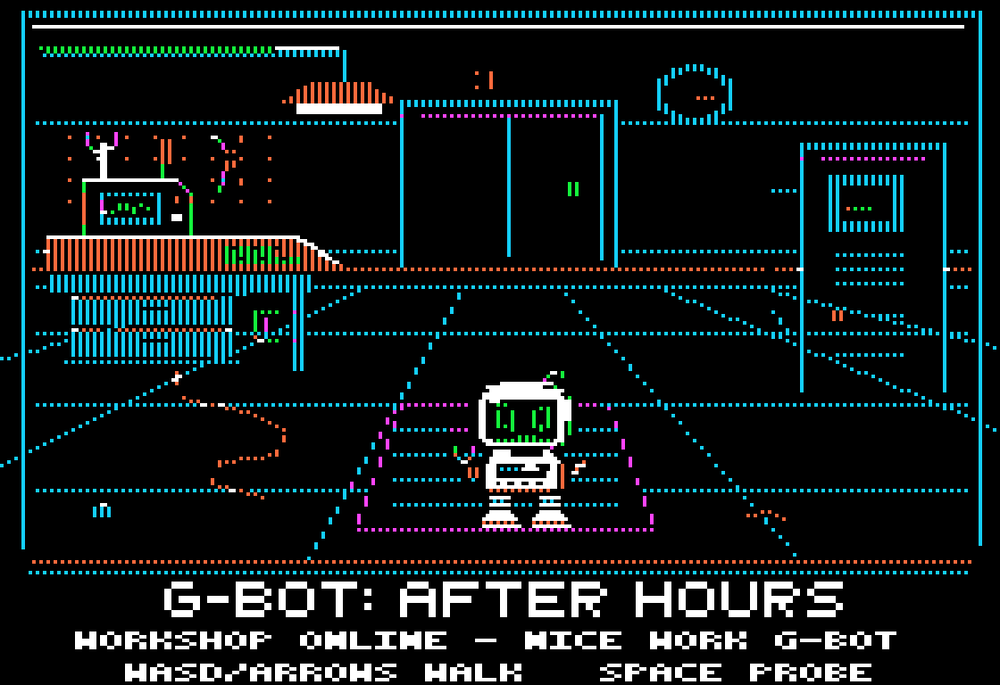
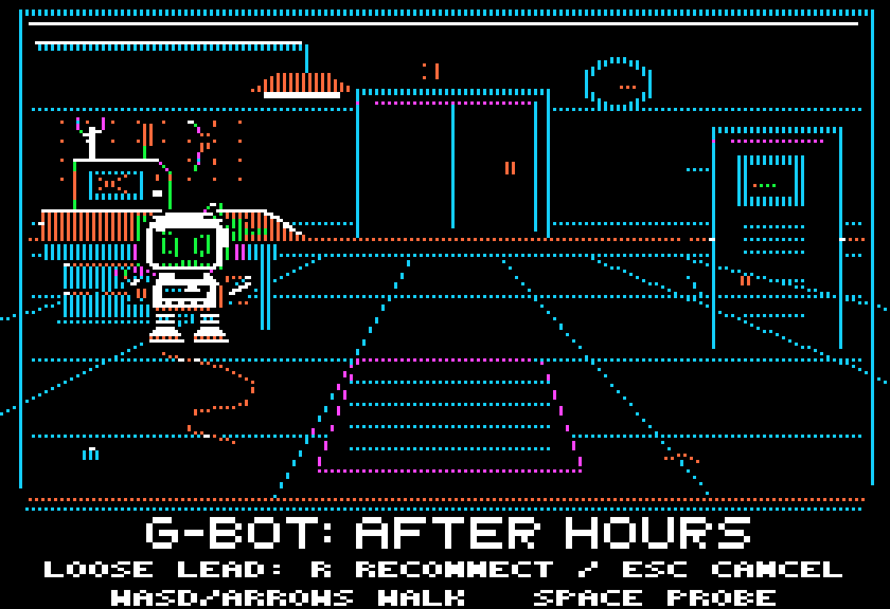

# G-Bot: After Hours



**Second playable milestone: G-Bot makes his first real repair.**
The official title is **G-Bot: After Hours**; the stable project folder remains
`Projects/GBotAdventure`.

## What's playable

- An original, fixed workshop in true Apple II color HGR: a tool board, oscilloscope,
  parts bench, terminal, cables and a service mat in a slightly elevated view.
- A **42 × 44-pixel masked G-Bot**, including his arms and chunky boots. His large
  green CRT face, sloped cream/white enclosure, chest drive, belly keys, grabber,
  repair probe and bent aerial carry over from the original portrait.
- Four-direction walking with alternating weighted feet and a small body bob.
  Sideward glances, rear service vents, and a front-facing idle blink give him
  character. The chest activity light briefly dims with the idle blink.
- Solid room edges, bench and terminal; clean background restoration over floor
  seams, cables and furniture. No sprite trails or XOR drawing.
- A visibly faulted **left workbench terminal**, an orange service socket on the
  bench front, contextual diagnostics and a small inspect/reconnect interaction.
- Restoring the connection boots the terminal's green waveform, energizes the
  ceiling conduit/task light and changes the rear door indicator from orange to
  green. The door itself does **not** open yet. Power stays on for this session.
- The original robot size, readable face, walking, blink and probe pose remain intact.

This is a **single-room repair prototype**, not the finished adventure. The rear
room door remains decorative. There are no other rooms, enemies, combat,
lives, checkpoints, saves or story reveals in this build. Those belong to later
collaboration; the underlying mystery and twists are not finalized here.

## Play the included disk

The self-booting [disk/gbot-after-hours.dsk](disk/gbot-after-hours.dsk) needs no build
step. Target: **Apple II+ or IIe, 48 KB, Disk II**, stock NMOS 6502 instructions.

Close MAME before pulling disk updates. With the usual two PowerShell tabs:

**Tab 1**, already at the main `AppleII` folder:
```powershell
git pull
```

**Tab 2**, already inside `MAME`:
```powershell
.\mame.exe apple2e -flop1 ..\Projects\GBotAdventure\disk\gbot-after-hours.dsk -window
```

For II+, use `apple2p` instead of `apple2e`. In AppleWin, insert this `.dsk` in
Drive 1 and boot an Apple II+/IIe with at least 48 KB. The disk is a raw boot disk,
not a DOS filesystem. The program never writes to it.

### Controls

| Key | Action |
| --- | --- |
| W / Up | Walk toward the back wall |
| A / Left | Walk left |
| S / Down | Walk toward the front |
| D / Right | Walk right |
| Space | Extend probe; inspect the left workbench when in range |
| R | Reconnect the loose lead after inspection |
| Escape | Cancel inspection (walking away also cancels) |

The Apple II keyboard reports **key events, not independent held-key states**.
A tap starts a short, bounded four-tick walk (up to eight pixels); the robot then
stops unless another direction event arrives. IIe autorepeat continues walking
after its initial delay. On an original II+, hold **REPT with W/A/S/D** to repeat,
or tap to walk. II+ keyboards don't have all four arrow keys. This prototype
supports one direction at a time, not simultaneous/diagonal movement, and does
not latch the last key into endless motion. Blocked walks stop at the obstacle.

### Your first repair

1. Walk **left**, then **up to the front of the left workbench**. The orange socket
   is on its right apron, below the small terminal. The footer changes to
   **WORKBENCH: SPACE TO INSPECT** when you are close enough.
2. Tap **Space**. G-Bot finds a loose lead; the footer offers **R RECONNECT / ESC CANCEL**.
3. Press **R** to reconnect it. Watch **RECONNECTING** and his probe for a short,
   bounded pause, then **WORKSHOP ONLINE** and the room's powered-up details.
4. Walk normally again. Probing the same terminal reports that it is already online.

From the untouched starting position, eleven taps of **A** and five taps of **W**
reach a valid service position. There is no required facing direction. Space away
from the socket reports **NO CONTACT** rather than silently pretending to repair.
Repeating/holding Space cannot confirm the repair; **R** is a deliberate second
step. This is an introductory diagnosis/action, not yet a circuit-routing puzzle.
Repair progress briefly holds G-Bot in place and ignores other keys; it always
finishes. Resetting/rebooting starts with the fault again. No disk data is saved.




## Build

Uses the workshop's existing **ca65 / ld65** installation. No WSL, Java,
AppleCommander, Python or Pillow is required for the native Windows build:

```powershell
.\Projects\GBotAdventure\build.ps1
# Or build and launch:
.\Projects\GBotAdventure\build.ps1 -Run
```

Tools are resolved under `Tools\cc65\bin`, with MAME under `MAME\mame.exe`.
The build only uses this project's files. It does not rebuild or modify Rockfall.

On the development box / Linux:

```sh
python3 Projects/GBotAdventure/tools/build.py
# Optional explicit tool directory:
python3 Projects/GBotAdventure/tools/build.py --cc65 /path/to/cc65/bin
```

The Python build uses only the standard library and the checked-in native art.
Both build routes use the same linker layout and DOS-order sector mapping.

### Art regeneration (optional)

With Python 3 and Pillow installed:

```powershell
python Projects/GBotAdventure/tools/gen_workshop.py
python Projects/GBotAdventure/tools/gen_concept.py
```

`gen_workshop.py` authors the separate, **robot-free background** and 14 masked
animation frames, plus `src/interaction.inc` (diagnostic pixels and visual patch
lookup tables). `gen_concept.py` regenerates the original portrait without
changing it. Neither imports Rockfall or uses external artwork/fonts. Build again
after regenerating workshop art. The checked-in `.hgr` and sprite `.bin` are
required native build inputs, not modern images loaded by the game.

## Graphics / memory notes

- Full-screen **280 × 192 HGR**, with the room above row 160 and native HGR title
  and controls below. No text-page switching or IIe-only video features.
- `$0800–$0BFF`: read-only bootloader; `$0C00–$0D6F`: boot decoding scratch.
  No high-score sector, write routine or Rockfall runtime is carried over.
- `$1000–$1133`: shifted sprite pixels; `$1200–$1333`: opacity;
  `$1400–$142B`: row palette phases; `$50–$89`: engine zero-page state/scratch.
- `$2000–$3FFF` and `$4000–$5FFF`: alternating HGR display pages.
- `$6000–$757F`: engine and lookup tables (including alignment padding).
  `$7580–$7FFF` remains available: 2,688 bytes.
- `$8000–$9FFF`: canonical native room (8,192 bytes; repair/status changes update it in RAM).
- `$A000–$BF47`: 14 original 42 × 44 frames (8,008 bytes).
  `$BF48–$BFFF`: 184 spare bytes. Total current layout slack: **2,872 bytes**.
- A fixed 24 KB load fills tracks 1–6; the complete disk is 143,360 bytes.
  No language card, auxiliary RAM or expansion sound hardware is needed.

Before drawing, only the **offscreen page's previous 7-byte × 44-line rectangle**
is restored from the canonical room. The diagnostic strip and 52 changed visual
bytes are then synchronized to that offscreen page before the next robot is drawn. The next sprite is shifted in software and
mask-composited, then the completed page is selected. Every horizontal position
is even, preserving artifact color parity at all seven byte alignments. At an
opaque edge, the sprite selects that byte's palette phase; the underlying room
bytes are restored exactly when it moves away. The two display pages normally
show successive animation states, not identical frames.

Measured game ticks average approximately **69,400 cycles (~14.4 updates/second
at 1 MHz)** on both Bobbin models, including repair/status synchronization. The
worst sampled tick was **73,099 cycles**; the reconnect lasts about 1.7 seconds.

There is no IIe-only vertical-blank wait: the II+ uses the same bounded software
loop. Page selection is not beam-synchronized, so a CRT can show a slight transition
tear, but no partially erased sprite is deliberately displayed.

## Validation / screenshots

[IIe screenshot, native 280 × 192](screenshots/workshop_idle_enhanced-280.png) ·
[Walking pose](screenshots/workshop_walking_enhanced.png) ·
[Probe gesture](screenshots/workshop_probe_enhanced.png) ·
[II+ workshop](screenshots/workshop_idle_plus.png)

Screenshots are decoded **from actual Bobbin HGR RAM after booting this disk**,
not the generator's concept preview. Enlargements use nearest-neighbor pixels.
The renderer uses a discrete artifact-color approximation (adjacent lit bits white;
isolated bits colored by parity and byte phase), not an analog NTSC/CRT simulation.
Real monitors and emulator filter settings will look a little different.

`tests/workshop_test.py` boots a disposable disk in Bobbin through a PTY and its
JSON control socket. It checks WASD and Apple arrow codes, four facings/foot poses,
all seven horizontal byte alignments, all four walls, both furniture fronts and
sides, the probe, idle blink and no stuck movement. Every sampled frame compares
**both entire 8 KB display pages** against an independent software compositor,
including old-background restoration and HGR holes. It independently reconstructs
faulted/online room bytes and each diagnostic, verifies the canonical buffer, and
checks far probes, reaching the service position through real movement, inspection,
Space repeat, cancel/walk-away, explicit R confirmation, bounded progress, online
visuals on both pages, idempotent re-probing and movement afterward. It also checks
unchanged source sprites, resident loader preservation and an unchanged disk. The IIe run checked **603 frames**, the II+ run **597**, with both full pages
compared each time. Frame-cost checks
combine Bobbin's completed video-frame count and partial-frame cycle count.

```sh
# Build first, then (each run is bounded by the caller):
timeout 180 python3 Projects/GBotAdventure/tests/workshop_test.py enhanced
timeout 180 python3 Projects/GBotAdventure/tests/workshop_test.py plus
```

These tests run on Bobbin's IIe and II+ models. Native Windows PowerShell,
MAME, AppleWin and physical hardware have not been run in this Linux environment;
their launch/build instructions follow the workshop's existing native layout.

## Original portrait and future direction


[Native full-screen portrait](art/gbot-workshop.hgr) ·
[280 × 192 portrait](art/gbot-workshop-280.png)

G-Bot is a curious repair robot, not a combat tank. The wider idea remains a
room-to-room repair adventure: a workshop, a dark power room and a security room
are potential next steps, with repairs that affect other rooms and gradually
reveal the facility's story. Room checkpoints rather than limited lives are the
current direction. Two disks remain an option **if the world earns them**, not a
requirement to fill space. First, we can judge the robot's size, personality and
movement together in this one room.
