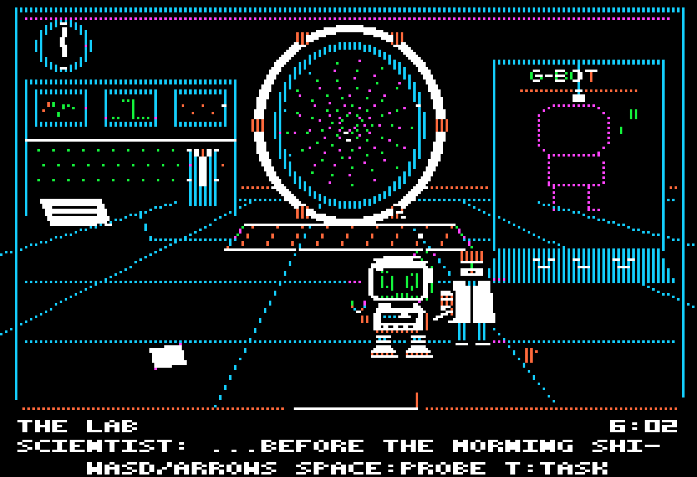
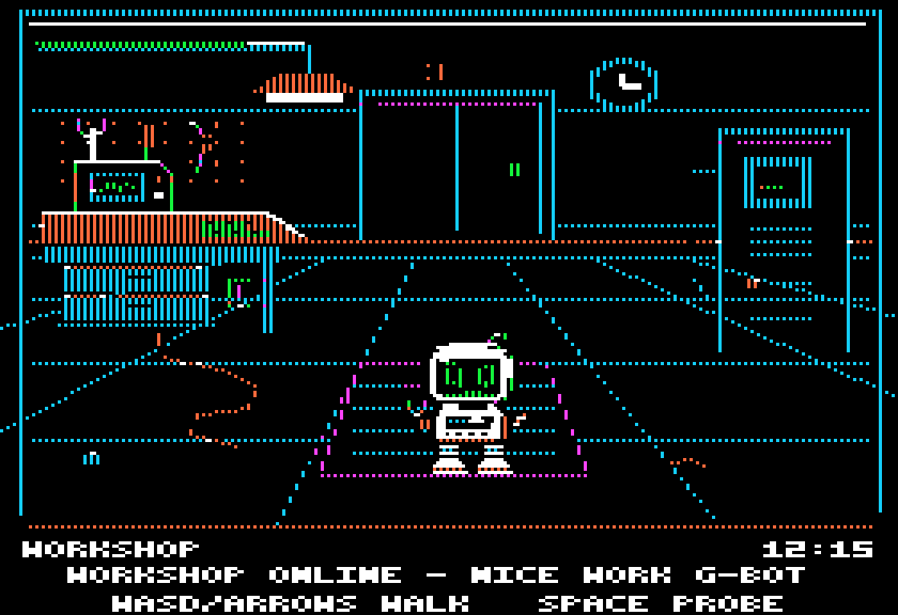
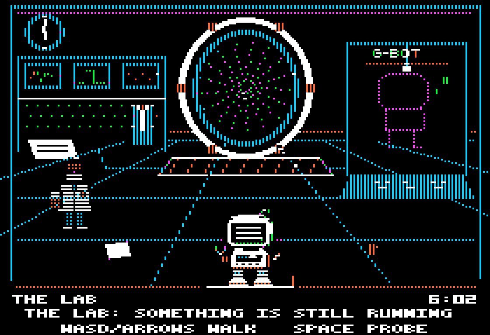
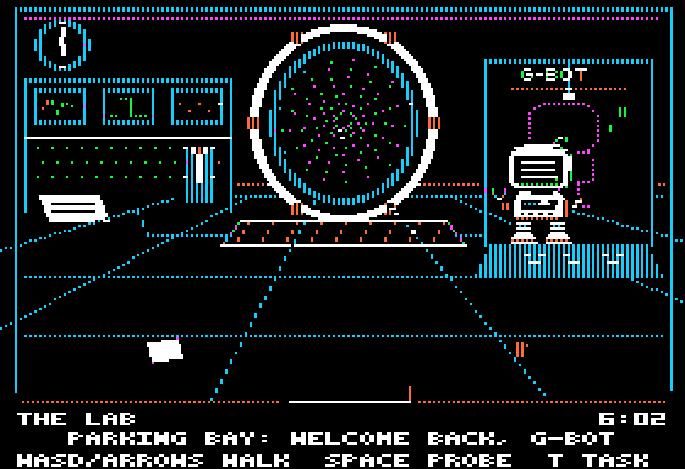

# G-Bot: After Hours



**Fifth playable milestone: THE LAB.** Fix the workshop, find the fuse, light the
power room, slip past the security room's guard bot, and use the security desk to
unlock the lab, where something is still running. Four connected rooms.
The official title is **G-Bot: After Hours**; the stable project folder remains
`Projects/GBotAdventure`.

## What's playable

- An original, fixed workshop in true Apple II color HGR: a tool board, oscilloscope,
  parts bench, terminal, cables and a service mat in a slightly elevated view.
- A **42 × 44-pixel masked G-Bot**, including his arms and chunky boots. His large
  green CRT face, sloped cream/white enclosure, chest drive, belly keys, grabber,
  repair probe and bent aerial carry over from the original portrait.
- Four-direction walking with alternating weighted feet and a small body bob.
  Sideward glances, rear service vents, and a front-facing idle blink give him
  character. The chest activity light briefly dims with the idle blink.
- Solid room edges, bench and terminal; clean background restoration over floor
  seams, cables and furniture. No sprite trails or XOR drawing.
- A visibly faulted **left workbench terminal**, an orange service socket on the
  bench front, contextual diagnostics and a small inspect/reconnect interaction.
- Restoring the connection boots the terminal's green waveform, energizes the
  ceiling conduit/task light and changes the rear door indicator from orange to
  green. Power stays on for this session.
- **The rear door.** Before the repair, walking into it reports
  **DOOR SEALED - FIX WORKBENCH FIRST**. Afterwards, walking north into it slides
  the door open and G-Bot steps through into the second room.
- **The DARK POWER ROOM**: an original, almost-black HGR room made of sparse, dim,
  dotted outlines G-Bot can barely make out: pipe runs, a dead bulb, a locker, a
  big dead generator with its gauge needle on zero, and a feed cable to a
  **breaker panel**. The only light is a warm wedge spilling through the doorway
  behind him, the panel's orange standby lamp and two sleeping controller LEDs.
- Probing the breaker panel reports **NO POWER - FIND FUSE** (its fuse holder is
  visibly empty). One small white glint in the old locker gives the fuse away.
- **The fuse.** Probing the locker finds it: **FOUND A FUSE!** A little fuse icon
  appears at the right end of the status line while G-Bot carries it.
- **Fitting it** works like the workbench: Space at the panel offers
  **R TO FIT / ESC CANCEL**; R fits it during a short, bounded pause. The lights
  come on: a **lit power room** with solid outlines, the bulb glowing, breakers set
  and green, the fuse seated, the generator's gauge needle up and the west
  security door unlocked. It stays lit for the rest of the session.
- **The SECURITY ROOM**, through that west door (sealed until the power is back):
  a monitor wall of camera feeds, the security desk with phone and mug, ceiling
  cameras, evidence lockers, a wall clock that doesn't agree with the workshop's,
  and a striped patrol lane across the floor.
- **One guard bot.** It is still rebooting when G-Bot first walks in, then rolls
  steadily back and forth along the lane. Touching it sends G-Bot back to the
  room's entry door (**GUARD: WORK ORDER NOT RECOGNIZED**). There are no lives, damage or
  game over. You can cross the lane safely by timing it.
- **The lab door.** A new door in the security room's back wall, marked **LAB**,
  with an orange lock lamp. Walking into it says
  **LAB DOOR LOCKED - TRY THE DESK**. Probing the security desk releases it:
  the lamp turns green and the desk's line runs on with
  **...AND THE LAB DOOR CLICKS OPEN**.
- **THE LAB**: a time-chamber ring humming on its dais, a bank of consoles, a lab
  clock showing yet another time (about 6:02), a dropped clipboard page and cup,
  and a robot **parking bay** with "G-BOT" over a dotted outline exactly his
  shape, a charging arm and a CHARGE lamp.
- **The flickering scientist.** A masked, double-buffered sprite in a lab coat with a
  clipboard. She is never quite in sync: she flickers in (alternate scanlines only),
  stays about three seconds, flickers out, and turns up somewhere else a few
  seconds later. She is harmless and never moves G-Bot.
- **Probe everything.** The chamber, the bay, the consoles and the scientist each
  give a short clue, and some lines run on into a second one. The bay recognizes
  G-Bot. See the walkthrough below.
- Every door works both ways, and the repair, fuse, power and lab-door states are
  kept as G-Bot moves between all four rooms.
- The original robot size, readable face, walking, blink and probe pose remain intact.

This is a **four-room prototype**, not the finished adventure. There is no
combat, lives, saves, lab puzzle or story choice in this build yet. The clocks,
the empty cameras, the scientist and the bay only hint at what happened here.

## Play the included disk

The self-booting [disk/gbot-after-hours.dsk](disk/gbot-after-hours.dsk) needs no build
step. Target: **Apple II+ or IIe, 48 KB, Disk II**, stock NMOS 6502 instructions.

Close MAME before pulling disk updates. With the usual two PowerShell tabs:

**Tab 1**, already at the main `AppleII` folder:
```powershell
git pull
```

**Tab 2**, already inside `MAME`:
```powershell
.\mame.exe apple2e -flop1 ..\Projects\GBotAdventure\disk\gbot-after-hours.dsk -window
```

For II+, use `apple2p` instead of `apple2e`. In AppleWin, insert this `.dsk` in
Drive 1 and boot an Apple II+/IIe with at least 48 KB. The disk is a raw boot disk,
not a DOS filesystem. The program never writes to it. Keep the disk in drive 1
while playing: each room change reads that room from the disk.

### Controls

| Key | Action |
| --- | --- |
| W / Up | Walk toward the back wall |
| A / Left | Walk left |
| S / Down | Walk toward the front |
| D / Right | Walk right |
| Space | Extend probe; inspect the workbench, locker, breaker panel, security desk, or anything in the lab |
| R | Reconnect the loose lead / fit the fuse after inspection |
| Escape | Cancel inspection (walking away also cancels) |

The Apple II keyboard reports **key events, not independent held-key states**.
A tap starts a short, bounded four-tick walk (up to eight pixels); the robot then
stops unless another direction event arrives. IIe autorepeat continues walking
after its initial delay. On an original II+, hold **REPT with W/A/S/D** to repeat,
or tap to walk. II+ keyboards don't have all four arrow keys. This prototype
supports one direction at a time, not simultaneous/diagonal movement, and does
not latch the last key into endless motion. Blocked walks stop at the obstacle.

### Your first repair

1. Walk **left**, then **up to the front of the left workbench**. The orange socket
   is on its right apron, below the small terminal. The footer changes to
   **WORKBENCH: SPACE TO INSPECT** when you are close enough.
2. Tap **Space**. G-Bot finds a loose lead; the footer offers **R RECONNECT / ESC CANCEL**.
3. Press **R** to reconnect it. Watch **RECONNECTING** and his probe for a short,
   bounded pause, then **WORKSHOP ONLINE** and the room's powered-up details.
4. Walk normally again. Probing the same terminal reports that it is already online.

From the untouched starting position, eleven taps of **A** and five taps of **W**
reach a valid service position. There is no required facing direction. Space away
from the socket reports **NO CONTACT** rather than silently pretending to repair.
Repeating/holding Space cannot confirm the repair; **R** is a deliberate second
step. This is an introductory diagnosis/action, not yet a circuit-routing puzzle.
Repair progress briefly holds G-Bot in place and ignores other keys; it always
finishes. Resetting/rebooting starts with the fault again. No disk data is saved.




### Into the dark power room

1. After the repair, walk to the **middle of the back wall** and keep walking
   **up** into the rear door (its indicator is green). From the starting spot,
   he is already lined up: just keep tapping or holding **W**. The door slides open, there is
   a short pause while the room loads from disk (about 1½-2½ seconds), and G-Bot
   arrives at the lit doorway at the bottom of the power room, facing in.
2. Walk **left and up** to the breaker panel on the back wall (top left). The
   footer changes to **BREAKER PANEL: SPACE TO PROBE**. Tap **Space**:
   **NO POWER - FIND FUSE**. Space elsewhere reports that it is too dark.
   The generator on the right is solid.
3. To go back, walk to the **middle of the bottom edge** (the lit doorway) and keep
   walking **down**. G-Bot returns to the workshop facing out of the rear door, with
   power still on. You can go back and forth as often as you like.


### The fuse and the lights

1. In the dark power room, walk to the **middle of the back wall**, to the old
   locker with the tiny glint (from the doorway, just keep walking **up**). The
   footer reads **OLD LOCKER: SPACE TO PROBE**. Tap **Space**: **FOUND A FUSE!**
   The fuse icon appears at the end of the status line.
2. Walk **left** along the back wall to the breaker panel. Tap **Space**:
   **FUSE FITS: R TO FIT / ESC CANCEL**. Press **R**. After **FITTING FUSE...**
   the room reloads lit: **POWER RESTORED - WEST DOOR OPEN**.


### The security room and its guard

1. Walk to the **left wall, lower half** (the door marked **SEC**, lamp green
   now) and keep walking **left**. Before the fuse is fitted it says
   **SECURITY DOOR SEALED - NO POWER**.
2. G-Bot arrives at the security room's **east door** (bottom right): the room's
   checkpoint. The guard is booting for about three seconds, then patrols the
   striped lane, one step at a time, end to end (a round trip takes ~12 s).
3. G-Bot is only caught when he is **on the lane** (roughly the middle band of
   the floor) and overlaps the guard. The back wall strip and the front strip are
   safe. Wait until the guard rolls away, then cross. If it touches him he's sent
   back to the east door; nothing else is lost.
4. Visit the **security desk** (back left; the desk itself is solid). Its footer
   reads **SECURITY DESK: SPACE TO PROBE**. Space shows what the monitors see.
5. Leave by walking **right** into the east door from the front strip. You arrive
   at the power room's west door. Every door can be used again in either direction.


### The lab

1. The **LAB** door is in the middle of the security room's back wall, with a
   small lamp to its right. Before you probe the desk, walking into it says
   **LAB DOOR LOCKED - TRY THE DESK**.
2. Probe the **security desk**. After the monitors line, the footer adds
   **...AND THE LAB DOOR CLICKS OPEN** and the lamp turns green.
3. From the desk, walk **right** along the back strip, which is safe from the guard,
   to the door's middle. Then keep walking **up**. The lab loads from disk, and
   G-Bot arrives at its bottom doorway: **THE LAB: SOMETHING IS STILL RUNNING**.
4. Look around and probe:
   - **Consoles** (back left): **CONSOLE: LOOP 4,817. ALL NOMINAL!** then
     **LAB CLOCK SAYS 6:02. NOBODY AGREES.**
   - **Time chamber** (walk up to the front of the dais; the dais is solid):
     **CHAMBER: LOOP ACTIVE. DO NOT DISTURB** then **...THE RING HUMS. IT KNOWS YOU.**
   - **Parking bay** (back right): just standing there gives
     **PARKING BAY: WELCOME BACK, G-BOT**. Probe it for
     **BAY: G-BOT. LAST SERVICE: TONIGHT.** then **...AND TONIGHT. AND TONIGHT.**
   - **The scientist**: walk close while she is visible:
     **SCIENTIST! SPACE TO SAY HELLO**. Probe for
     **SCIENTIST: ...BEFORE THE MORNING SHI-**. When she flickers away, it adds
     **...AND SHE FLICKERED OUT MID-WORD**.
5. To leave, walk to the **middle of the bottom edge** and keep walking **down**.
   You arrive back at the security room's lab door, on the guard-free back strip.







## Build

Uses the workshop's existing **ca65 / ld65** installation. No WSL, Java,
AppleCommander, Python or Pillow is required for the native Windows build:

```powershell
.\Projects\GBotAdventure\build.ps1
# Or build and launch:
.\Projects\GBotAdventure\build.ps1 -Run
```

Tools are resolved under `Tools\cc65\bin`, with MAME under `MAME\mame.exe`.
The build only uses this project's files. It does not rebuild or modify Rockfall.

On the development box / Linux:

```sh
python3 Projects/GBotAdventure/tools/build.py
# Optional explicit tool directory:
python3 Projects/GBotAdventure/tools/build.py --cc65 /path/to/cc65/bin
```

The Python build uses only the standard library and the checked-in native art.
Both build routes use the same linker layout and DOS-order sector mapping.

### Art regeneration (optional)

With Python 3 and Pillow installed:

```powershell
python Projects/GBotAdventure/tools/gen_workshop.py
python Projects/GBotAdventure/tools/gen_power_room.py
python Projects/GBotAdventure/tools/gen_security.py
python Projects/GBotAdventure/tools/gen_lab.py
python Projects/GBotAdventure/tools/gen_concept.py
```

`gen_workshop.py` authors the separate, **robot-free background** and 14 masked
animation frames, plus `src/interaction.inc` (diagnostic pixels and visual patch
lookup tables, and every status-line message). `gen_power_room.py` authors the
dark and lit power rooms (`art/power-room.hgr`, `art/power-room-lit.hgr`).
`gen_security.py` authors the security room and the guard's six masked frames
(`art/security-room.hgr`, `art/guard-sprites.bin`), plus `src/security.inc`
(the lab-door lamp bytes). `gen_lab.py` authors the lab and the scientist's four
frames (`art/lab-room.hgr`, `art/scientist-sprites.bin`: solid and ghost, each
for even and odd columns). `gen_concept.py` regenerates the original portrait without
changing it. Neither imports Rockfall or uses external artwork/fonts. Build again
after regenerating workshop art. The checked-in `.hgr` and sprite `.bin` are
required native build inputs, not modern images loaded by the game.

## Graphics / memory notes

- Full-screen **280 × 192 HGR**, with the room above row 160 and native HGR title
  and controls below. No text-page switching or IIe-only video features.
- `$0800–$0A1A`: read-only bootloader, **kept resident** as the room loader
  (`LOADROOM` at `$0805` reads two tracks, `LOADONE` at `$0808` one);
  `$0C00–$0D6F`: disk decoding scratch.
  No high-score sector, write routine or Rockfall runtime is carried over.
- `$1000–$1133`: shifted sprite pixels; `$1200–$1333`: opacity;
  `$1400–$142B`: row palette phases (all three rebuilt every frame).
  `$1800–$1FFF`: the **current room's actor frames**. Either the guard's 6 masked
  frames (1,620 bytes, track 13, read at boot and again when G-Bot comes back
  from the lab) or the scientist's 4 (1,440 bytes, track 16, read on entering the
  lab). Both use the same 9-byte-per-row masked format and the same blitter.
- `$50–$A8`: engine zero-page state/scratch (`$8A` room, `$8C` panel,
  `$8D` fuse, `$8F–$97` guard, `$9D` lab door, `$9E` which actor is loaded,
  `$9F–$A5` the current actor, `$A6–$A8` scientist); `$26`, `$2B`, `$3C–$49`:
  loader zero page.
- `$2000–$3FFF` and `$4000–$5FFF`: alternating HGR display pages.
- `$6000–$6AC0` engine code, `$6B00–$7E7F` lookup tables, a 43-glyph status
  font (now with digits and a comma) and 43 status messages (40 bytes each).
  `$7E80–$7FFF` remains available: **384 bytes** (plus 63 bytes of alignment gap
  at `$6AC1`). The 1,280 bytes this milestone used went on the lab's 15 new
  messages (600 bytes), the generic actor/scientist code and the lab logic. The
  next room should move messages into a disk-loaded per-room bank, or pack them
  more tightly.
- `$8000–$9FFF`: the **current** room's canonical native background (8,192 bytes;
  repair/status changes update it in RAM).
- `$A000–$BF47`: 14 original 42 × 44 frames (8,008 bytes).
  `$BF48–$BFFF`: 184 spare bytes. Total slack: **631 bytes** in the main
  layout, plus 428 beside the guard frames or 608 beside the scientist's.
- Disk: track 0 boot; tracks 1–6 the fixed 24 KB boot load (the workshop room is
  tracks 3–4); **7–8 dark power room, 9–10 lit power room, 11–12 security room,
  13 guard frames, 14–15 lab, 16 scientist frames**. The complete disk is
  143,360 bytes; tracks 17–34 are free.
  No language card, auxiliary RAM or expansion sound hardware is needed.

**Why rooms load from disk.** Each HGR background is a full 8 KB and only one fits
beside the two display pages, engine and sprites. Rather than compress rooms (and
squeeze a decompressor plus a compressed workshop into the 1.4 KB left), a room
change re-uses the boot loader, which is already resident: it spins up the drive,
reads the next room's two tracks straight into `$8000`, and turns the motor off.
Leaving the power room reloads the pristine workshop from tracks 3–4; the repair
patches and status line are then re-applied from RAM state, so nothing is lost.
Fitting the fuse simply reloads the power room from its lit tracks, and every
later visit picks lit or dark from the panel state.
This scales to more rooms (two tracks each) and keeps the art uncompressed and
exact. The cost is a short pause at each door (measured below). The disk is
only ever read.

Each room has at most one moving "actor": the guard in the security room, the
scientist in the lab. Both share one byte-aligned masked blitter (4 bytes wide;
30 rows for the guard, 40 for the scientist). Her ghost frames have every other
row fully transparent, so the flicker costs nothing extra and erases cleanly.

Before drawing, only the **offscreen page's previous 7-byte × 44-line rectangle**
(and the actor's previous 4-byte rectangle, at its own height and spot) is
restored from the canonical room. The diagnostic strip and 52 changed visual
bytes are then synchronized to that offscreen page before the sprites are drawn.
With both old rectangles restored first, G-Bot and the actor are composited
**back to front by where their feet are**, each masked over what the page already
holds, so they can pass in front of each other without trails. The guard moves a
whole byte (7 pixels) per step and needs no shifting. Each pose is stored for
even and odd columns so its colors never flip. The next sprite is shifted in software and
mask-composited, then the completed page is selected. Every horizontal position
is even, preserving artifact color parity at all seven byte alignments. At an
opaque edge, the sprite selects that byte's palette phase; the underlying room
bytes are restored exactly when it moves away. The two display pages normally
show successive animation states, not identical frames.

Measured game ticks average approximately **70,600 cycles (~14.2 updates/second
at 1 MHz)** over the whole test on both Bobbin models. The worst sampled tick was
**86,439 cycles**, in the security room with both sprites; the workshop and
power room are unchanged at about 69,000–73,500. The reconnect and fuse fitting
each last about 1.7 seconds. A room change (door beat, disk spin-up, seek,
two-track read, both pages rebuilt) took at most **2.48 million cycles (~2.4 s)**
in Bobbin's Disk II emulation.

There is no IIe-only vertical-blank wait: the II+ uses the same bounded software
loop. Page selection is not beam-synchronized, so a CRT can show a slight transition
tear, but no partially erased sprite is deliberately displayed.

## Validation / screenshots

[IIe screenshot, native 280 × 192](screenshots/workshop_idle_enhanced-280.png) ·
[Walking pose](screenshots/workshop_walking_enhanced.png) ·
[Probe gesture](screenshots/workshop_probe_enhanced.png) ·
[II+ workshop](screenshots/workshop_idle_plus.png) ·
[Power room arrival, native 280 × 192](screenshots/power_arrive_enhanced-280.png) ·
[II+ power room](screenshots/power_arrive_plus.png) ·
[Locker prompt](screenshots/power_locker_enhanced.png) ·
[Security room arrival, guard rebooting](screenshots/security_arrive_enhanced.png) ·
[II+ security room](screenshots/security_patrol_plus.png)

Screenshots are decoded **from actual Bobbin HGR RAM after booting this disk**,
not the generator's concept preview. Enlargements use nearest-neighbor pixels.
The renderer uses a discrete artifact-color approximation (adjacent lit bits white;
isolated bits colored by parity and byte phase), not an analog NTSC/CRT simulation.
Real monitors and emulator filter settings will look a little different.

`tests/workshop_test.py` boots a disposable disk in Bobbin through a PTY and its
JSON control socket. It checks WASD and Apple arrow codes, four facings/foot poses,
all seven horizontal byte alignments, all four walls, both furniture fronts and
sides, the probe, idle blink and no stuck movement. Every sampled frame compares
**both entire 8 KB display pages** against an independent software compositor,
including old-background restoration and HGR holes. It independently reconstructs
faulted/online room bytes and each diagnostic, verifies the canonical buffer, and
checks far probes, reaching the service position through real movement, inspection,
Space repeat, cancel/walk-away, explicit R confirmation, bounded progress, online
visuals on both pages, idempotent re-probing and movement afterward. It also checks
unchanged source sprites, resident loader preservation and an unchanged disk.

The room tests check that the door is sealed before the repair; that walking
into it afterwards streams in the power room byte-for-byte from tracks 7–8; all
four power-room walls (including the closed bottom edge beside the doorway), the
generator front and side; the far probe, walking to the breaker panel with real
controls, its prompt and **NO POWER - FIND FUSE**; that standing in the doorway
doesn't leave; and that walking out restores the workshop with the repair kept.
A second round trip follows. Both pages are rebuilt and compared after every
transition, so leftover robots or trails from the previous room would fail.

This milestone's tests cover the sealed security door; the panel without a fuse
(and R doing nothing); walking to the locker, the fuse pickup, the HUD icon and the
empty locker afterwards; Escape, Space repeat and R at the panel; the fit and the
lit room streamed from tracks 9–10; the lit room still lit after a trip to the
workshop; the security door opening at its checkpoint; the guard rebooting,
waking, and patrolling one byte at a time to both ends while the checkpoint stays
safe; a touch sending G-Bot back; a timed crossing with real controls to the desk;
the desk probe and solidity; and round trips through all three rooms (15
transitions). The independent compositor also draws the guard, with the same
depth ordering, so every frame checks both sprites on both pages. The IIe run
checked **1,513 frames**, the II+ run **1,507**, with both full pages
compared each time. Frame-cost checks
combine Bobbin's completed video-frame count and partial-frame cycle count.

```sh
# Build first, then (each run is bounded by the caller):
timeout 900 python3 Projects/GBotAdventure/tests/workshop_test.py enhanced
timeout 900 python3 Projects/GBotAdventure/tests/workshop_test.py plus
```

These tests run on Bobbin's IIe and II+ models. Native Windows PowerShell,
MAME, AppleWin and physical hardware have not been run in this Linux environment;
their launch/build instructions follow the workshop's existing native layout.

## Original portrait and future direction


[Native full-screen portrait](art/gbot-workshop.hgr) ·
[280 × 192 portrait](art/gbot-workshop-280.png)

G-Bot is a curious repair robot, not a combat tank. The wider idea remains a
room-to-room repair adventure: the workshop, power room and security room now
exist, with repairs that affect other rooms and gradually reveal the facility's
story. Room checkpoints rather than limited lives are the direction already used
for the guard. Two disks remain an option **if the world earns them**, not a
requirement to fill space.
