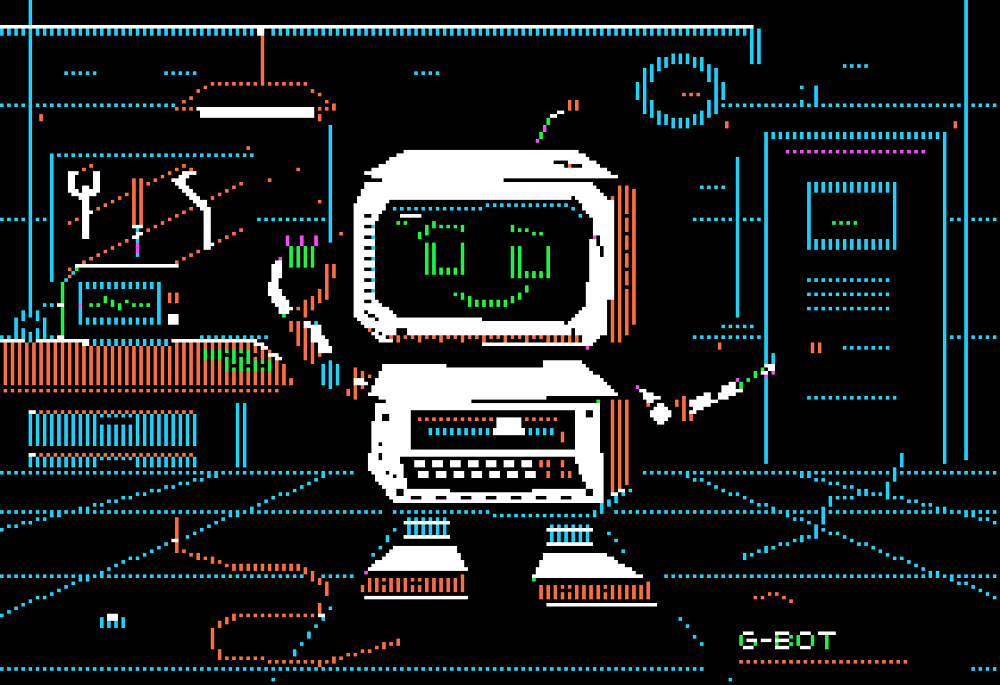

# G-Bot Adventure



*First character concept: a little repair robot keeping the workshop company after everyone has gone.*

**Working title — not final.** An optional naming idea is **G-Bot: After Hours**.
The stable workshop folder is `Projects/GBotAdventure` regardless of the eventual title.

## Status

**Character concept artwork is now available; gameplay is still at the planning/scaffold stage.**
There is no game executable or bootable disk yet. The illustration explores the
character and mood, not a finished gameplay sprite or a promise of in-game scale.
Everything under “Proposed” remains open to collaboration.

## The first portrait

G-Bot is a curious mechanic, not a tank: a scuffed cream-colored CRT shell,
asymmetric green pixel eyes, a crooked smile, a chest disk drive and amber
activity light, chunky work boots, an open grabber holding a logic module,
and an extended repair probe. A sleeping terminal, hanging tools, oscilloscope,
and loose cables make up the quiet workshop. White/black texture and warm
orange accents suggest aged cream plastic within the Apple II palette.

This is an original, authored **280 × 192 full-screen standard Apple II HGR**
illustration—not a modern picture recolored to look retro. The displayed PNG
is decoded from the actual screen bytes, including seven-pixel byte groups,
the shared palette/phase bit, pixel parity, and adjacent-bit white.

- [Large preview](art/gbot-workshop.png): 1120 × 768, crisp 4× nearest-neighbor pixels.
- [Logical-size preview](art/gbot-workshop-280.png): 280 × 192.
- [Native HGR screen](art/gbot-workshop.hgr): exactly 8,192 bytes, no file header.
- [Reproducible generator](tools/gen_concept.py): original shapes, details and lettering;
  no external image or font assets. Encoder/preview conventions follow Rockfall's
  existing landscape tools without modifying or importing them.

### Regenerate the art

From the workshop root, with Python 3 and Pillow available:

```powershell
python Projects/GBotAdventure/tools/gen_concept.py
```

On systems where Python is named `python3`, use that command instead. This
regenerates all three assets and checks deterministic screen generation,
unique scanline addresses, and zero-filled screen holes. It is an **art tool**,
not a gameplay build.

### Native screen format / viewing

Load the raw file at **$2000–$3FFF** in an Apple II emulator that supports binary
memory loading. Select graphics ($C050), full-screen ($C052), page one ($C054),
and high-resolution ($C057). Do not call `HGR` *after* loading: it clears the page.
The file is a memory image, not a bootable disk or a DOS binary with a load header.

For row `y`, its 40 display bytes begin at offset
`((y & 7) << 10) | (((y >> 3) & 7) << 7) | ((y >> 6) * 40)`.
There are 7,680 display bytes and 512 padding bytes. Both PNGs come from decoding
the saved `.hgr`, not from the unconstrained painting canvas.

The preview is a discrete artifact-color approximation, matching the workshop's
existing neighbor/parity renderer; it does not simulate analog NTSC, CRT bloom,
or half-dot phase displacement. Real displays and emulator color filters will
vary. Byte layout and deterministic regeneration are validated; an attempted
Bobbin headless export timed out, so this portrait is **not emulator-verified**.

## Proposed concept

An original, fixed-room repair adventure with exploration and bursts of danger.
Room-to-room transitions take inspiration from Berzerk and Castle Wolfenstein,
with original assets and design rather than copied characters, rooms, or mechanics.
Bringing broken equipment back online could open routes—and wake security systems
that were better left switched off.

The proposed protagonist is a curious maintenance robot, not a combat tank:
- A squat, battered cream-colored body inspired by an Apple II.
- A green screen face with expressive pixel eyes and a chest disk-drive light.
- Chunky feet, one grabber hand, and a repair/zap probe on the other arm.
- A larger, readable sprite with walking animation and a visibly extending repair probe.

Fixed rooms are intended to leave more room for character and environment detail
without requiring scrolling. Sprite dimensions, graphics techniques, controls,
and memory budgets are still to be worked out in the prototype.

## Proposed first prototype

Start with three connected rooms to test the repair/explore loop before building
an entire facility:
1. **Workshop/tutorial:** a quiet space to learn movement and a simple repair.
2. **Dark power room:** restore power and discover what it changes elsewhere.
3. **Security room:** react to systems awakened by restored power, introducing danger.

The first milestone would be readable movement, room transitions, and one repair
with a visible consequence—not a complete game. None of this is implemented yet.

## Intended technical direction

- Apple II+/IIe, 48 KB RAM; 6502 assembly using the workshop's ca65/ld65 toolchain.
- Follow the existing native Windows PowerShell build workflow with the workshop's
  cc65, AppleCommander/JRE, and MAME setup; no WSL or new major tool installation planned.
- Two disks are acceptable later if the world needs them, but are not a requirement
  or an established disk layout. Prototype scope and memory usage come first.

There are deliberately no **game** build/run commands yet: no buildable game or disk
exists for this project. The art-only generator above is available now. Rockfall
remains separate and unchanged.

## Folder layout

- `src/` — reserved for future assembly source and project assets.
- `disk/` — reserved for future distributable disk images.
- `tests/` — reserved for future checks and emulator tests.
- `art/` — native HGR character concept and its decoded PNG previews.
- `tools/` — reproducible concept-art generator; future project-specific helpers.
- `build/` — future generated intermediates; ignored by the workshop `.gitignore`
  and created locally/by a future build, not tracked in Git.

The empty tracked directories use `.gitkeep` only to preserve the scaffold.
See the [workshop README](../../README.md) for shared tools and repository layout.
