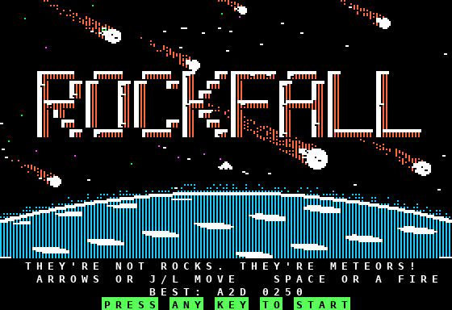
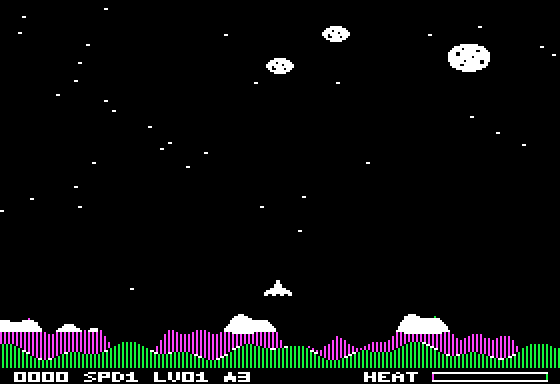
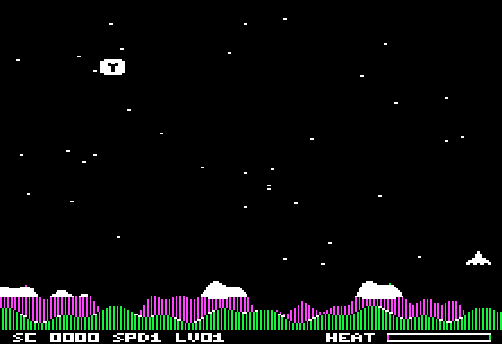
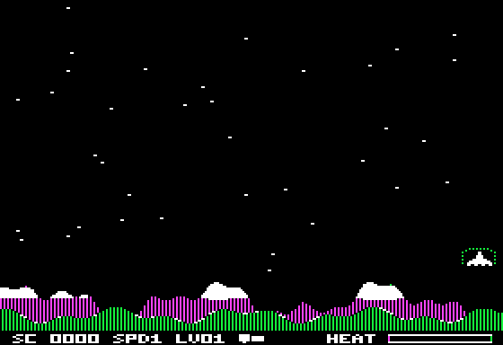
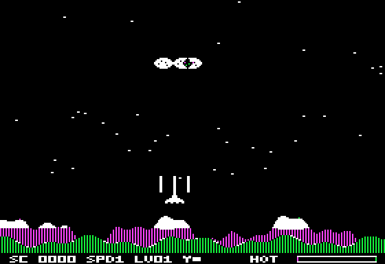
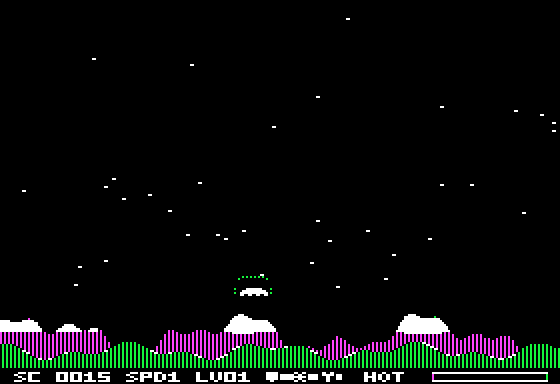
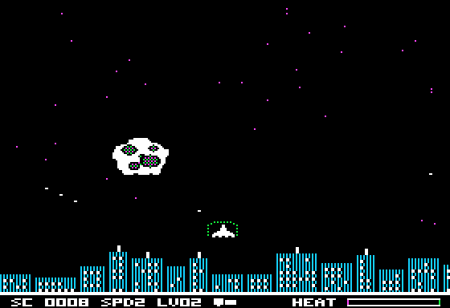

# ROCKFALL (Apple II hi-res, 6502 assembly)

Dodge the falling rocks. Self-booting disk, no DOS. Apple IIe or II+, 48K.

Controls: Left/Right arrows or J / L to move, Space or A to fire the laser. Fly into a falling power-up
capsule to collect it (SHIELD, COOL, SPREAD; see Power-ups below).
On a IIe the ship stops when you let go of the key; on a II+ it glides a few frames.
Game over: any key plays again, Esc goes back to the title.
Demo: after one idle pass of the title art and high-score screen, an attract demo plays with a simple
AI that dodges and taps fire (DEMO blinks on the HUD). Any key starts a real game; a death returns to the
title without saving scores.
Laser heat: every shot heats the laser (HEAT bar, bottom right). Fire slowly and it stays cool; hold fire and it
overheats on the 6th shot: a warning buzz, the label turns to HOT, the bar blinks, and the laser is locked for ~1.2 s
until it has cooled all the way down.
Score: +1 per rock dodged, +5 per rock shot. Speed goes up every 15 rocks (max 5).
Levels: every LEVELSPD=3 speed-up steps (steps keep counting after SPEED caps at 5) is a new level: a
brief LEVEL N banner (~1.5 s, rising chime), then play continues. HUD shows LV. New stars change colour per
level (white, violet, green, repeating). Constants/variables at the top of rockfall.s; tests/level_test.py.
Controls: left/right arrows or J/L move; space or A fires (heat permitting). IIe: ship moves while the key is
held and stops on release ($C010 key-down bit). II+: a press moves ~16 frames, key repeats extend it ~6 frames each.
High scores: top 5 (initials, score, level) on the title screen and after game over; the best score shows on the title screen (the HUD's old HI slot now shows active power-ups). A qualifying
score asks for initials: type A-Z, or cycle with arrows/joystick; RETURN, space or button 0 confirms each letter.
Table lives in its own page at $1B00 (5 x 8 bytes, "RF",1 at $1B28, check byte $1B2B: EOR $00-$2B = 0;
defaults in src/hsdef.inc). It is saved on the disk at track 0, physical sector 15 (.dsk offset $0F00):
the loader reads it at boot, and after initials are entered the game calls the loader's wrsect ($080B:
A=page, X=track, Y=phys sector; DOS 3.3-timed 6+2 write) - motor on ~1 s, then off. Write-protected or
failed writes show a message and keep the scores in memory. Rebuilding the disk resets the scores.
MAME: the .dsk must be writable. Play a copy (e.g. Disks\rockfall-play.dsk) so git pull doesn't conflict
with the tracked disk/rockfall.dsk.

## Screenshots

*Title screen: the "rocks" are really meteors falling from space.*

*In game: level 1 over the mountains, with the parallax starfield, falling meteors and the HUD.*

*A glowing SPREAD capsule falling: catch it with the ship before it reaches the ground.*

*SHIELD: a dotted bubble around the ship absorbs one hit.*

*SPREAD: every shot fires three bolts.*

*All three power-ups active: icons with shrinking timer bars, packed side by side where HI used to be.*

## Files
- src/rockfall.s    game source (ca65)
- src/font.s       tiny 3x5 hi-res font for the status line, made by tools/gen_font.py
- src/sprites.s     ship (7 pre-shifted copies) + rock data, made by tools/gen_sprites.js
- src/boot.s       stage-2 loader (track 0): reads the game from tracks 1-6 to $6000
- src/rockfall.cfg  linker config: loader at $0800 (track 0), game at $6000-$BFFF (max 24K)
- tests/loader_test.py pads the game image with a pattern to 20-24K, boots it and checks RAM byte for byte
- build.ps1         Windows build (+ -Run to launch MAME)
- disk/rockfall.dsk bootable 140K disk image
- tools/            gen_sprites.js (node, only to change the art), gen_font.py, mkdisk.py, a2enc.js
- tests/emu_test.py bobbin-ai test (boots disk, presses keys, checks memory; rebuilds the screen from game state
  and compares it byte-for-byte, so any leftover pixels show up)

## Build and run (PowerShell, from Projects\Rockfall)
    Unblock-File .\build.ps1
    .\build.ps1          # build only
    .\build.ps1 -Run     # build, then start MAME
Or by hand, from the MAME folder:
    .\mame.exe apple2e -flop1 ..\Projects\Rockfall\disk\rockfall.dsk -window
(`apple2p` for a II+.)

## How it works
- Boot (two stages, no DOS):
  1. Byte $0800 = $03 tells the Disk II boot ROM to load physical sectors 0-2 of track 0
     (src/boot.s) to $0800-$0AFF; it jumps to $0801 with X = slot*16.
  2. The loader shows LOADING... (one * per track), then reads tracks 1..N with its own
     6+2 GCR read code (DOS 3.3 style, cycle-safe read loops, 4+4 address field, data
     checksum), taking sectors in whatever order they pass under the head, and stepping
     the head with the four phase magnets (~19 ms per half-track, then settle). Then
     JMP $6000 with X = slot*16. Byte $0804 = N (number of game tracks) is filled in by
     the disk builders from the image size.
  - Disk layout: build/rockfall.bin = 4K track-0 image + game image; 256-byte chunk i goes to
    track i/16, PHYSICAL sector i%16 (mkdisk.py and build.ps1 then map physical to
    DOS-order slots in the .dsk). Both builders produce byte-identical disks.
  - The loader stays resident at $0800-$0CFF (text page 2, unused) with a jump table for
    the game: $0805 seek (A = track), $0808 rdsect, $080B wrsect (placeholder for saving
    high scores later: needs prenibblize + a 32-cycle write loop via $C08F/$C08D).
- Graphics: full-screen hi-res, double-buffered on HGR page 1 ($2000) and page 2 ($4000).
  Each frame is drawn on the hidden page, then $C054/$C055 flips it into view, so there is no flicker.
  For every page the game remembers what it last drew there (ship, rocks, bolt, stars at $1900-$1ABF);
  next time it XOR-erases exactly that and draws the new state. The field is rows 0-159; SCORE / SPD / LV / power-ups / HEAT
  are drawn on both pages at rows 172-176 with a small hi-res font (mixed text mode is off during play,
  because text page 2 at $0800 holds the resident loader). The game-over screen switches to page 1
  with the 4 text lines (text page 1 at $0400 is free). Sprites use XOR, so drawing the same thing again erases it. Rocks sit on byte columns. The ship
  uses pre-shifted copies so it moves 2 px at a time.
- Stars: 36 small white dots (2 pixels each) fall behind the rocks. Half of them move 1 row
  every 2 frames and half every 4, which gives a parallax look. A star that reaches row 156
  comes back at the top in a new random spot. Stars are XORed like everything else, so a rock
  or the ship passing over one never leaves a mark. They don't count for collisions. Star
  tables sit in RAM at $1800-$18FF, below the HGR pages.
- Laser: one bolt at a time, 12 rows long, flying up 12 rows per frame from the ship's nose.
  A rock is hit if it overlaps the bolt's rows and the bolt's x is inside the rock. Hit = rock
  gone (it respawns at the top later), +5 points, and a crackle.
- Heat (Parsec-style): constants at the top of rockfall.s. HEATSHOT=16 (was 18) per shot, HEATMAX=63,
  cools 1 per HEATCOOL=2 frames (~20/s at ~40 fps), every frame while overheated. Reaching 63 locks the
  laser until heat is back to HEATOK=0. Firing while locked only clicks. The bar (byte cols 31-38,
  56 px = HEAT*7/8, even widths) is written straight to both pages, only when it changes.
- Collision: a bounding box in 2-pixel units.
- Sound: the $C030 speaker with timed loops. Two-voice dark title music (see Title music) and a noise
  burst plus falling sweep on a crash, a falling-pitch pew when you fire, a crackle on a hit, and a
  ~31 ms two-tone buzz (1 kHz / 600 Hz) on overheat. tools/render_sfx.py renders all three to a WAV preview.
- Memory: text page 1 $0400-$07FF (title/game over), loader $0800-$0AFF + buffers $0B00-$0C6F,
  tables $1800-$1ABF, HGR $2000-$5FFF, game code+data $6000-$6DDE (3.5K of 24K: up to $BFFF).

## Landscapes
A 32-row scenery strip (hi-res rows 152-183) sits under the play field and changes on every level:
MOUNTAINS, CITY, MOON, DESERT (then it cycles). The ship flies at rows 140-147, rocks vanish when they reach
row 152, stars stay in rows 0-151 and the HUD is at rows 186-190. The scenes are generated by
`tools/gen_land.py` (procedural colour grids + ASCII stamps, or raw 40x32 a2sprite .bin exports) into
`src/land.inc` (RLE, ~3.1 KB for all four). Run `python tools/gen_land.py` after editing it, then build.

## Bonus flyer
Every ~10-23 s a comet or a satellite (blinking beacon) streaks across rows 8-39, left->right or
right->left, ~2 s to cross. Shoot it: comet 50, satellite 100, with a burst, a points popup and a
rising-arpeggio bonus sound. Sprites: `tools/gen_flyer.py` -> `src/flyer.inc`. Tweak constants
(FLYSPD, FTMIN, PTLEN, FLYDLY) at the top of `rockfall.s`. The frame delay is shortened while a flyer
is up, so the game speed stays the same.

## Title screen
Attract mode: hi-res art (cratered orange/white ROCKFALL logo, flaming meteors, earth limb with a
glowing atmosphere, a small ship) with a 4-line text window (tagline, controls, best score, flashing
PRESS ANY KEY TO START) for ~15 s (ARTT), then the text high-score view for ~5 s, repeating. Stars twinkle and
a meteor streaks across now and then. Any key starts. Art: `tools/gen_title.py` -> `src/title.inc` (RLE).
It animates on page 1 only (no page flipping): mixed mode on page 2 would show text page 2 = the loader at $0800.

## Rock sizes
| Size | Sprite | Speed | Laser | Points |
|---|---|---|---|---|
| Pebble | 1 byte x 6 rows | 1.5x SPD | 1 hit | +3 |
| Rock | 2 bytes x 8 rows | 1x SPD | 1 hit | +5 |
| Boulder | 3 bytes x 14 rows | 0.5x SPD | 2 hits (cracks on the 1st) | +15, burst + "15" |

Spawn odds out of 16 (pebble/rock/boulder): L1 3/12/1, L2 4/10/2, L3 5/9/2, L4+ 5/8/3; at most 2 boulders at
once (MAXLG). Tables `rsize`/`rsmall`/`rlarge`/`rpts`... at the end of `rockfall.s`; sprites in
`tools/gen_sprites.js`. Frame pacing (`fdelay`, FDBASE) subtracts each object's drawing cost so the game
speed is the same whatever is on screen.

## Power-ups
A destroyed boulder drops a capsule about 1 in 3 times (DROPB=86/256), a shot-down flyer 1 in 2 (DROPF=128/256);
one capsule at a time. Capsules (2 bytes x 9 rows, icon inside, blinking every 4 frames) fall 1 row per frame
and vanish at the landscape line; touch one with the ship to collect it (pickup chime).

| Power-up | Icon | Effect |
|---|---|---|
| SHIELD | shield | dotted bubble around the ship; absorbs one rock hit (the rock is destroyed, glass-break sound) |
| COOL | snowflake | heat reset to 0 and shots add no heat; the gauge label reads COOL |
| SPREAD | fan | each shot fires 3 bolts: centre + 10 px left and right; each bolt hits on its own |

Each lasts PTIME=200 ticks of 2 frames (~10 s); collecting the same type again restarts its timer. The
bubble blinks in the last ~1 s; expiry plays a two-note power-down blip. The level banner pauses the timers,
a new game clears them. HUD: the active ones are packed left to right at byte cols 19/21/23 (3x5 icon + a
7-px bar that shrinks with the timer), redrawn only when they change. Pacing: `fdelay` also subtracts the
capsule (CCOST), each bolt in flight (LCOST centre, BCOST side) and the shield bubble (SCOST).
tests/powerup_test.py covers drops, pickup, each effect, HUD stacking/expiry, refresh, banner pause, new game.

## Lives
3 ships per game (`NLIVES`, ZP `LIVES` = $4E). HUD: `0000 SPD1 LV01 ^3` - the ship glyph (font 27) and the
ships left sit at cols 16-17, before the power-up slots. A hit without shield (rock, or the boss reaching
the ship row) plays the crash, then respawns: field cleared, rocks re-staggered (~0.6 s grace), heat
reset, score/level/power-ups kept. A boss in play is due again and re-enters with full HP. The last ship
lost is game over. Tests poke `LIVES=1` for legacy one-ship play; `tests/lives_test.py` covers lives.

## Boss meteor
Every 3rd level-up (levels 4, 7, 10, ...) a boss is due: new rocks stop, and once the field is clear a
huge cratered meteor (35x24 px, rock slot 0, `RSIZE` 4) sinks from the top, 1 row every 4 frames, drifting
side to side and shedding a pebble every 40 frames (at most 2 on screen). It takes 7 laser hits (`BOSSHP`),
so with the heat gauge you have to fire in short bursts, cool off and dodge; spread bolts count too.
Destroying it: +100, a burst popup, a guaranteed SHIELD or COOL capsule, and the speed goes up a notch;
normal rocks resume. If it reaches the ship row it is a ship hit (a shield absorbs it and the boss is lost).
Sprite: `tools/gen_boss.py` -> `src/boss.inc`. Test: `tests/boss_test.py`.

## Title music
The title plays a dark two-voice track on the stock speaker ($C030, 1-bit): D minor with a Phrygian
flat-2 (Eb), about 86 BPM. A 2-bar "doom" intro (a low D drone with a creeping Eb) plays once, then a
12-bar loop (about 30 s) repeats seamlessly: a pulsing low bass ostinato (root, root, octave, root,
root, fifth, octave, root/flat-2) under a slow lead melody with vibrato. Progression:
Dm Dm Eb Dm | Bb Gm A A | Dm Eb Bb A.

How it works (`music` in src/rockfall.s): each voice is a 16-bit phase accumulator and every carry
toggles the speaker, so the two square waves are XOR-mixed. The loop is exactly 63 cycles per
iteration on every path, so pitch is exact (f = 1020484/63 x inc / 131072). The title's `tick`
plays 176 iterations (about 11 ms, the length of the old wait) instead of calling WAIT. Between
segments the sequencer advances, the vibrato steps, the stars and streaks animate and the keyboard
is polled, so a key starts the game within about one tick and the music stops.
The song is a note/duration table written by `tools/gen_music.py` (into src/music.inc).
`tools/render_music.py [out.wav]` renders a WAV preview by simulating the speaker at the real cycle
timings. tests/music_test.py checks the toggles, the alternation, the loop wrap and the key response.
