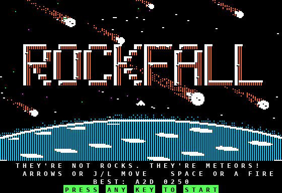

# apple2-dev

Apple II development: fast 6502 assembly games, Windows/browser tools, and a MAME test runner.
Layout mirrors `C:\Users\rjguerrero\Projects\AppleII\`.

## Layout
- `Scripts/` – `Run-Apple2.ps1` + `runner.lua`: run a program in MAME headlessly and write `results.txt` (see `docs/README-runner.md`).
- `Projects/BeginnerTesting/` – `hello.bas`, `store.s` smoke tests.
- `Projects/Rockfall/` – hi-res avoid-the-rocks game (ca65 source, `build.ps1`, builds bootable `disk/rockfall.dsk`).
- `Tools/a2sprite/` – offline HTML sprite / Applesoft shape-table editor (open `a2sprite.html`).
- `docs/` – documentation.

## Not included (install separately)
- **MAME** in `MAME\` plus Apple II ROMs (`apple2e`, `apple2p`, disk controller). **ROMs are not included** – supply your own legally.
- **cc65** (ca65/ld65) in `Tools\cc65\`
- **AppleCommander** in `Tools\AppleCommander\` and a **JDK/JRE** (`Tools\jre\`) to build disk images.

## Run Rockfall


More screenshots and details: [Projects/Rockfall/README.md](Projects/Rockfall/README.md).

From `MAME\`:
```
.\mame.exe apple2e -flop1 ..\Projects\Rockfall\disk\rockfall.dsk -window
```
Rebuild: `cd Projects\Rockfall; .\build.ps1 -Run` (you may need `Unblock-File .\build.ps1`).

A ready-to-boot `disk/rockfall.dsk` is included; `build.ps1` rebuilds it.
